# Analog Integrated Circuits & Operational Amplifier Design in Cadence Virtuoso (TSMC 180nm CMOS)

[](https://opensource.org/licenses/MIT)
[](#ca3-three-corner-pvt-summary-two-stage-miller-op-amp)
[](#cadence-virtuoso-setup--reproduction)
[](#topology-benchmark--verification-summary)
[](https://ut.ac.ir)

Engineering portfolio for **Analog Integrated Circuit Design** and **CMOS Operational Amplifiers** completed in the School of Electrical and Computer Engineering at the **University of Tehran**.

This repository contains the Cadence Virtuoso OpenAccess design libraries (`TSMC 180nm CMOS`, `V_DD = 1.8 V`), Spectre simulation results across process-voltage-temperature (PVT) corners, an analytical Python hand-design benchmark script, course lab manuals, and full project reports for **Electronics III** and **Electronics III Laboratory**.

---

## CA3 Three-Corner PVT Summary (Two-Stage Miller Op-Amp)

Nominal and corner Spectre simulations for the tuned **PMOS-input Two-Stage Miller Op-Amp** (`L = 360 nm`, `I_0 = 185 uA`, `C_c = 3 pF`, `R_z = 1 kOhm`) from `CA3_Final_Project_TwoStage_Miller_CMFB_OpAmp.pdf`:

| Parameter / Metric | Nominal (`TT, +27°C`) | Fast Corner (`FF, -40°C`) | Slow Corner (`SS, +120°C`) |
|:---|:---:|:---:|:---:|
| **Process Technology** | TSMC 180nm CMOS (`L = 360 nm`) | TSMC 180nm CMOS | TSMC 180nm CMOS |
| **Supply Voltage ($V_{DD}$)** | $1.8\,\text{V}$ | $1.8\,\text{V}$ | $1.8\,\text{V}$ |
| **Open-Loop DC Gain ($A_{v0}$)** | **$64.5\,\text{dB}$** | $60.2\,\text{dB}$ | $63.0\,\text{dB}$ |
| **Unity-Gain Bandwidth ($\text{UGBW}$)** | **$357\,\text{MHz}$** | $520\,\text{MHz}$ | $233\,\text{MHz}$ |
| **Phase Margin ($\text{PM}$)** | **$74^\circ$** | $60^\circ$ | $92^\circ$ |
| **Max Common-Mode Rejection Ratio ($\text{CMRR}$)** | **$72.6\,\text{dB}$** | $68.1\,\text{dB}$ | $71.7\,\text{dB}$ |
| **Max Output Voltage Swing** | **$1.41\,\text{V}$** | $1.51\,\text{V}$ | $1.34\,\text{V}$ |
| **Total Quiescent Current (AC / DC)** | **$545\,\mu\text{A}$ / $525\,\mu\text{A}$** | $557\,\mu\text{A}$ / $526\,\mu\text{A}$ | $543\,\mu\text{A}$ / $525\,\mu\text{A}$ |

---

## Circuit Architecture & Block Diagrams

### 1. CA2: Folded-Cascode Fully Differential OTA with Continuous-Time CMFB
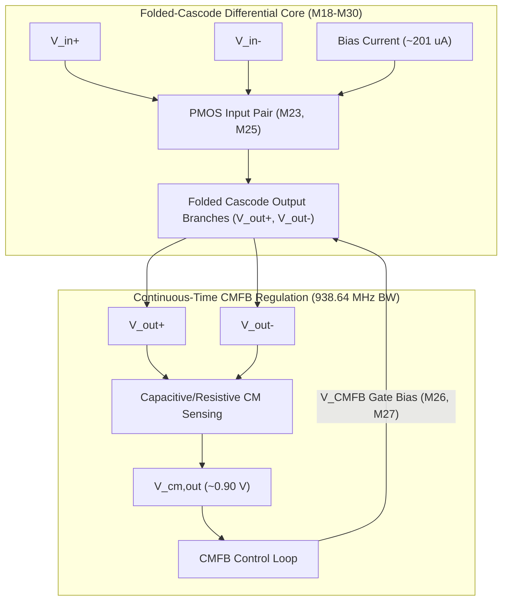

### 2. CA3: PMOS-Input Two-Stage Miller-Compensated Op-Amp
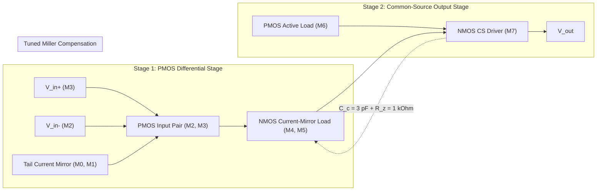

---

## Topology Benchmark & Verification Summary

| Coursework Module | Architecture & Technology | Supply ($V_{DD}$) | DC Gain ($A_{v0}$) | Unity-Gain BW | Phase Margin / Notes | Power / Current | Verification Scope |
|:---|:---|:---:|:---:|:---:|:---:|:---:|:---:|
| **CA1 (`Q1`-`Q10`, `01-`)** | 180nm LC/SC Device Physics & CS Amplifier | $1.8\,\text{V}$ | $15.85\,\text{dB}$ (CS passband) | $f_T$ up to $72.81\,\text{GHz}$ (SC) | $R_{in}=64.29\,\text{k}\Omega$, $R_{out}=3.67\,\text{k}\Omega$ | Spectre DC / AC / Temp | Sweeps & Corners |
| **CA2 (`part1`, `02-`)** | Folded-Cascode Fully Differential OTA + CMFB | $1.8\,\text{V}$ | $62.58\,\text{dB}$ ($f_{-3\text{dB}}=416.87\,\text{kHz}$) | **$524.5\,\text{MHz}$** | CMFB $-3\text{dB}$ BW: **$938.64\,\text{MHz}$** | **$1.083\,\text{mA}$** ($1.949\,\text{mW}$) | Nominal Spectre + `region=2` |
| **CA3 (`Total`, `03-`)** | PMOS-Input Two-Stage Miller Op-Amp (`L=360nm`) | $1.8\,\text{V}$ | **$64.5\,\text{dB}$** | **$357\,\text{MHz}$** | **$\text{PM}=74^\circ$**, **$\text{CMRR}=72.6\,\text{dB}$** | **$545\,\mu\text{A}$** (~$0.98\,\text{mW}$) | **3-Corner PVT (`TT`/`FF`/`SS`)** |
| **Lab 1-5 (`04-`)** | Single-Stage, Diff Pair, Bias, Feedback, Physical Layout | $1.8\,\text{V}$ | Lab Manuals (`1`-`5`) | OA Cellviews (`Lab1`, `Lab4`, `Lab5`) | Includes `TotalAMP` (`layout.oa`) | Lab Curriculum | Virtuoso OpenAccess |

---

## Repository Architecture

```text
Analog-Integrated-Circuits-Cadence-Virtuoso/
├── 01-mosfet-characterization-cascode/      # CA1: 180nm LC vs. SC Characterization & CS Stage
│   └── cadence_oa/                         # Cadence OpenAccess database (Cells Q1 to Q10)
├── 02-cmfb-biasing-twostage-opamp/          # CA2: Bias Network & Folded-Cascode OTA + CMFB
│   └── cadence_oa/                         # OpenAccess cellview (part1)
├── 03-twostage-miller-cmfb-opamp-final/     # CA3: Final Op-Amp OpenAccess Project Library
│   └── cadence_oa/                         # Cells: Amplifier, Bias, CMFB_n, CMFB_p, feedback, Total
├── 04-cadence-virtuoso-lab-modules/         # Electronics III Lab Manuals & OA Libraries
│   ├── Lab1_SingleStage_CS_CG_Cascode/     # Lab1_Manual.pdf + cadence_oa (CS_Amp, CG_Amp, Cascode_Amp)
│   ├── Lab2_Differential_Amplifiers/       # Lab2_Manual.pdf
│   ├── Lab3_Current_Mirrors_Biasing/       # Lab3_Manual.pdf
│   ├── Lab4_Feedback_Frequency_Compensation/ # Lab4_Manual.pdf + cadence_oa (Amplifier, Bias, CMFB, OPAMP)
│   └── Lab5_Layout_DRC_LVS_PostLayout/     # Lab5_Manual.pdf + cadence_oa (TotalAMP layout.oa & schematic)
├── analysis/
│   └── opamp_analytical_bench.py           # Small-signal hand-design verifier (matches CA3 derivations)
├── docs/
│   └── media/                              # Cleaned Virtuoso schematics and Spectre plots
├── reports/                                # Academic project reports (PDF)
│   ├── CA1_MOSFET_Characterization_Cascode_AlirezaNajafi.pdf   # 22 pages
│   ├── CA2_CMFB_Biasing_OpAmp_AlirezaNajafi.pdf                # 14 pages
│   └── CA3_Final_Project_TwoStage_Miller_CMFB_OpAmp.pdf        # 8 pages
├── cds.lib                                 # Top-level Cadence Virtuoso library map
├── .gitignore                              # Excludes Cadence locks (.cdslck) & scratch files
├── LICENSE                                 # MIT License
└── README.md                               # Repository documentation
```

---

## Detailed Technical Modules

### 1. 180nm MOSFET Physics & CS Impedance Characterization (`01-mosfet-characterization-cascode`)

#### Long-Channel vs. Short-Channel Parameter Extraction (CA1, `nmos_lc` / `nmos_sc` / `pmos_lc` / `pmos_sc`)
Spectre DC, AC, temperature, and geometry sweeps (`W` and `L`) in TSMC 180nm verified velocity saturation and channel-length modulation effects:
- **Long-Channel vs. Short-Channel Extracted Parameters**:
  - `nmos_lc`: $\mu_n C_{ox} = 376\,\mu\text{A/V}^2$, $\lambda = 0.025\,\text{V}^{-1}$
  - `nmos_sc`: $\mu_n C_{ox} = 533\,\mu\text{A/V}^2$, $\lambda = 0.114\,\text{V}^{-1}$
  - `pmos_lc`: $\mu_p C_{ox} = 66\,\mu\text{A/V}^2$, $\lambda = 0.026\,\text{V}^{-1}$
  - `pmos_sc`: $\mu_p C_{ox} = 94\,\mu\text{A/V}^2$, $\lambda = 0.161\,\text{V}^{-1}$
- **Unity-Current-Gain Frequency ($f_T$, $20\log_{10}|I_s / I_g| = 0\,\text{dB}$)**:
  - **`FF, -40°C`**: Short-channel **$72.81\,\text{GHz}$**, Long-channel **$8.24\,\text{GHz}$**
  - **`SS, +120°C`**: Short-channel **$46.57\,\text{GHz}$**, Long-channel **$3.81\,\text{GHz}$**
- **Common-Source AC Impedance & Passband (`CA1 Q2`)**:
  - Midband voltage gain at **$15.85\,\text{dB}$** (marker at $4.38\,\text{Hz}$ lower roll-off), input resistance **$R_{in} = 64.29\,\text{k}\Omega$**, and output resistance **$R_{out} = 3.67\,\text{k}\Omega$**.

<p align="center">
  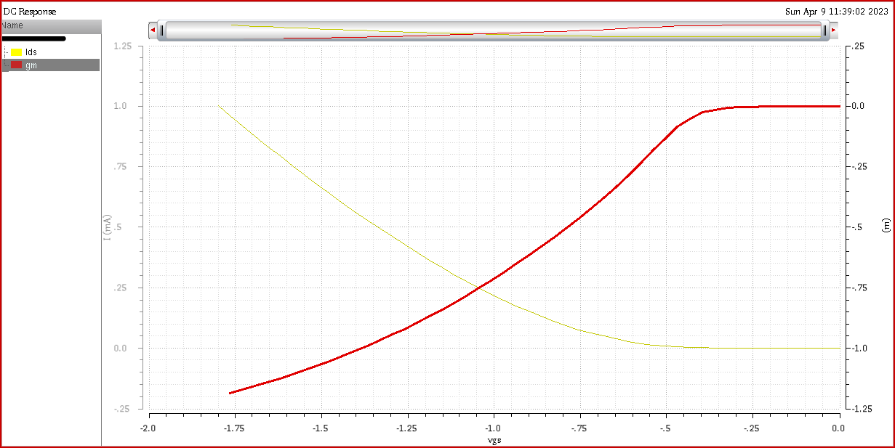
  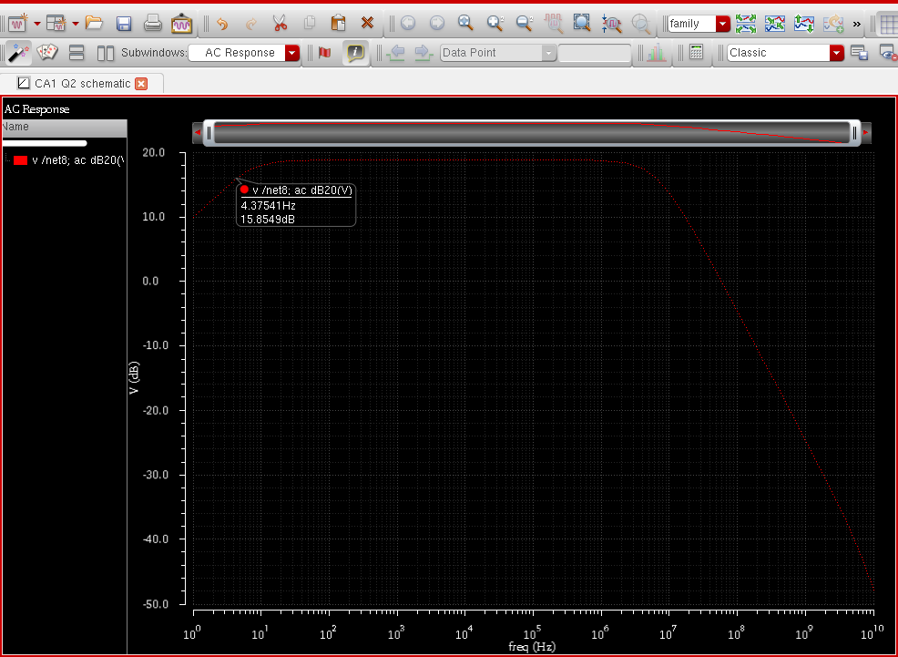
</p>

<p align="center">
  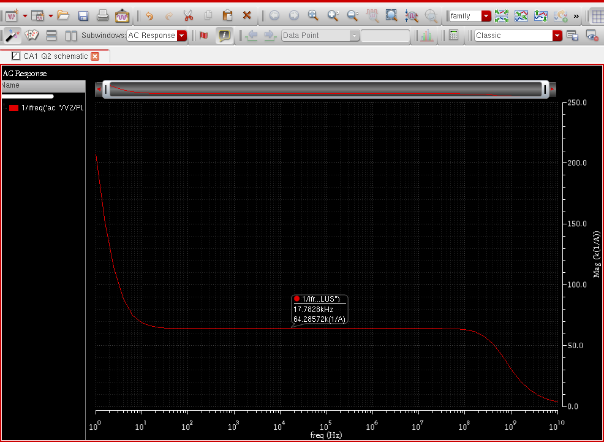
  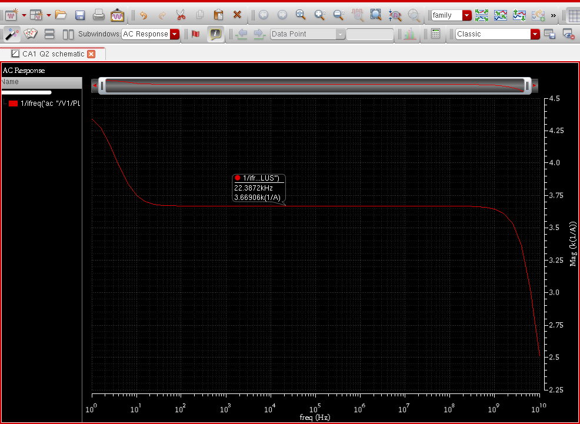
</p>

---

### 2. Folded-Cascode Differential OTA & High-Speed CMFB (`02-cmfb-biasing-twostage-opamp`)

#### Topology & Biasing (`part1`)
Fully differential folded-cascode OTA (`M18`-`M30`) paired with a continuous-time common-mode feedback (CMFB) loop locking the differential outputs ($V_{out+}, V_{out-}$) around $V_{DD}/2 = 0.902\,\text{V}$:
- **Reference Branch Bias Current**: **$\approx 201\,\mu\text{A}$** (`region = 2` saturation verified across all core devices).
- **CMFB Loop Bandwidth ($-3\,\text{dB}$)**: **$938.64\,\text{MHz}$**, keeping common-mode stabilization faster than the main signal path.
- **Differential Open-Loop AC Performance**: **$62.58\,\text{dB}$** DC gain ($115.3\,\text{Hz}$ marker), **$416.87\,\text{kHz}$** $-3\,\text{dB}$ bandwidth, and **$524.49\,\text{MHz}$** unity-gain bandwidth (`UGBW`).
- **Total Supply Draw**: **$1.0829\,\text{mA}$** ($1.949\,\text{mW}$ at $V_{DD} = 1.8\,\text{V}$).

<p align="center">
  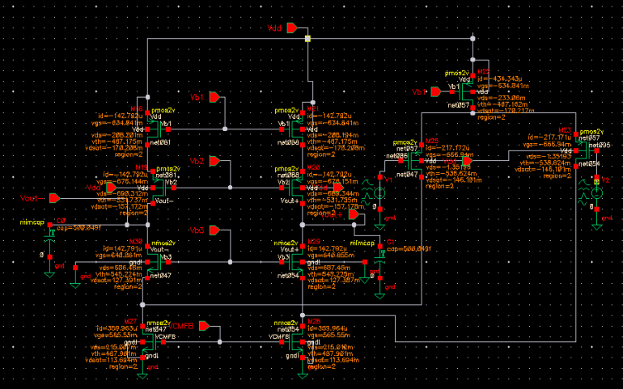
  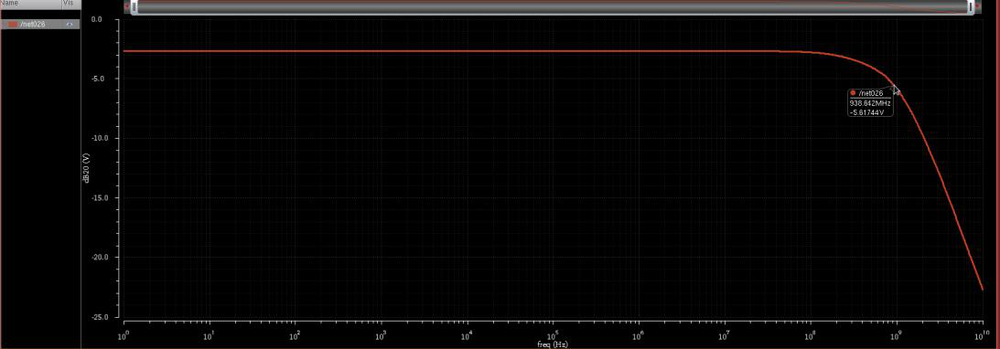
</p>

<p align="center">
  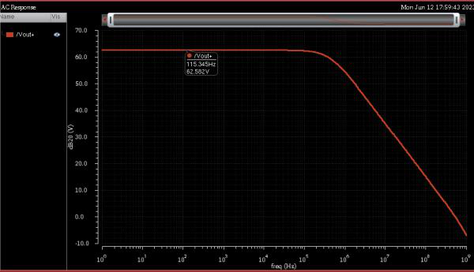
  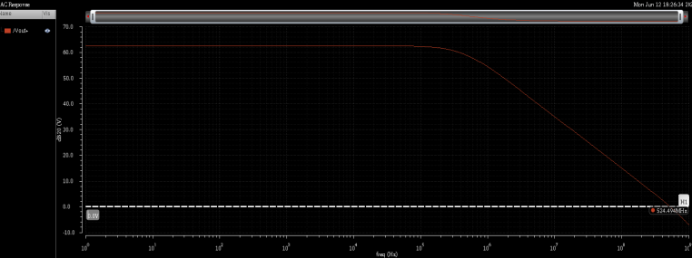
  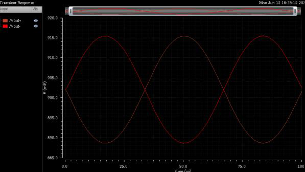
</p>

---

### 3. PMOS-Input Two-Stage Miller Op-Amp & 3-Corner PVT Verification (`03-twostage-miller-cmfb-opamp-final`)

#### Hand Calculation vs. Spectre Tuning
Designed in TSMC 180nm CMOS with uniform channel length $L = 360\,\text{nm}$ across `M0`-`M7` (PMOS differential pair `M2, M3`; tail mirror `M0, M1`; NMOS active load `M4, M5`; NMOS common-source stage `M7` with PMOS load `M6`):
1. **Analytical Hand Design (`analysis/opamp_analytical_bench.py`)**: Tail current $I_{D1} = 300\,\mu\text{A}$ ($I_0 = 100\,\mu\text{A}$), Stage 2 bias $I_{D6} = 320.45\,\mu\text{A}$, $C_c = 1.213\,\text{pF}$, and nulling resistor $R_z = 343.5\,\Omega$ placing the transmission zero in the left-half plane ($\omega_z < 0$).
2. **Spectre Schematic Tuning (`CA3` Final)**: Tuned compensation and reference branch in Spectre to **$I_0 = 185\,\mu\text{A}$**, **$C_c = 3\,\text{pF}$**, and **$R_z = 1\,\text{k}\Omega$** for robust phase margin and swing across temperature and process extremes.

#### Verified 3-Corner PVT Matrix (`V_DD = 1.8 V`)

| Corner | Process | Temp ($^\circ\text{C}$) | DC Gain ($A_{v0}$) | UGBW ($\text{MHz}$) | Phase Margin | Max CMRR ($\text{dB}$) | Max Swing ($\text{V}$) | Total Current (AC / DC) |
|:---:|:---:|:---:|:---:|:---:|:---:|:---:|:---:|:---:|
| **Nominal** | `TT` | $+27$ | **$64.5\,\text{dB}$** | **$357$** | **$74^\circ$** | **$72.6$** | **$1.41$** | $545\,\mu\text{A}$ / $525\,\mu\text{A}$ |
| **Fast** | `FF` | $-40$ | **$60.2\,\text{dB}$** | **$520$** | **$60^\circ$** | **$68.1$** | **$1.51$** | $557\,\mu\text{A}$ / $526\,\mu\text{A}$ |
| **Slow** | `SS` | $+120$ | **$63.0\,\text{dB}$** | **$233$** | **$92^\circ$** | **$71.7$** | **$1.34$** | $543\,\mu\text{A}$ / $525\,\mu\text{A}$ |

<p align="center">
  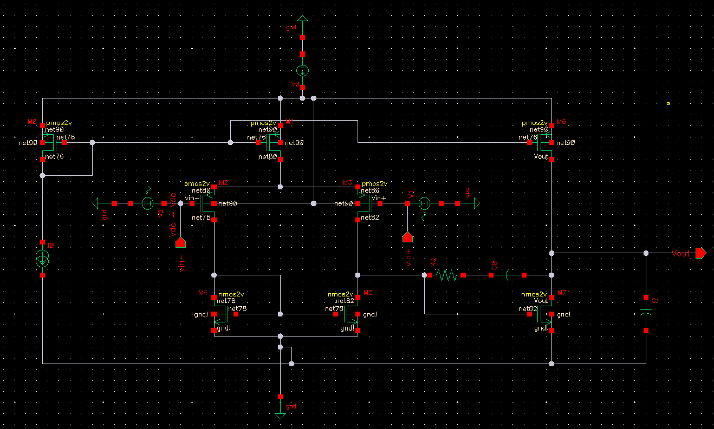
  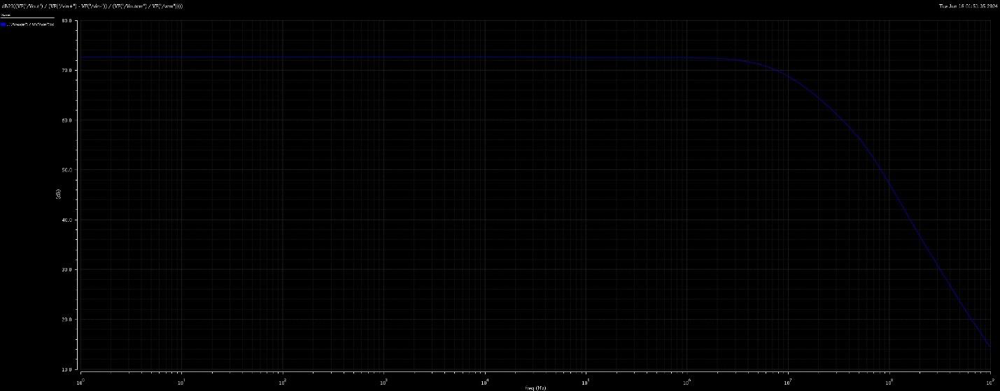
</p>

---

### 4. Cadence Virtuoso Laboratory Curriculum (`04-cadence-virtuoso-lab-modules`)

Five structured laboratory modules in Persian PDF manuals with accompanying OpenAccess libraries where implemented:
1. **Lab 1 (`Lab1_SingleStage_CS_CG_Cascode`)**: Frequency response of Common-Source, Common-Gate, and Cascode stages (`Lab1_Manual.pdf` + `cadence_oa`: `CS_Amp`, `CG_Amp`, `Cascode_Amp`).
2. **Lab 2 (`Lab2_Differential_Amplifiers`)**: Differential amplifier small-signal and frequency response (`Lab2_Manual.pdf`).
3. **Lab 3 (`Lab3_Current_Mirrors_Biasing`)**: Current mirrors and biasing architectures (`Lab3_Manual.pdf`).
4. **Lab 4 (`Lab4_Feedback_Frequency_Compensation`)**: Feedback amplifiers and frequency compensation (`Lab4_Manual.pdf` + `cadence_oa`: `Amplifier`, `Bias`, `CMFB`, `OPAMP`).
5. **Lab 5 (`Lab5_Layout_DRC_LVS_PostLayout`)**: Physical layout and post-layout flow (`Lab5_Manual.pdf` + `cadence_oa`: `Amplifier`, `Bias`, `CMFB`, `OPAMP`, `TotalAMP` including `layout.oa`).

---

## Academic Coursework Reports

Formal technical reports are archived in [`reports/`](reports/):

| Document | Pages | Contents Verified | Direct Link |
|:---|:---:|:---|:---:|
| **CA1: MOSFET Characterization & CS Analysis** | 22 | TSMC 180nm LC/SC parameter extraction, W/L and thermal sweeps, $f_T$ corners, and CS gain/impedance checks. | [PDF Link](reports/CA1_MOSFET_Characterization_Cascode_AlirezaNajafi.pdf) |
| **CA2: Folded-Cascode OTA & High-Speed CMFB** | 14 | Reference biasing (`~201 uA`), CMFB loop (`938.64 MHz`), AC gain (`62.58 dB`), and `UGBW` (`524.5 MHz`). | [PDF Link](reports/CA2_CMFB_Biasing_OpAmp_AlirezaNajafi.pdf) |
| **CA3: Two-Stage Miller Op-Amp Final Project** | 8 | Hand design (`analysis/opamp_analytical_bench.py`), Spectre tuning (`Cc=3 pF, Rz=1 kOhm, I0=185 uA`), and 3-corner PVT table. | [PDF Link](reports/CA3_Final_Project_TwoStage_Miller_CMFB_OpAmp.pdf) |

---

## Analytical Benchmark & Reproduction

### 1. Run Python Small-Signal Hand-Design Benchmark (`analysis/`)
```bash
python analysis/opamp_analytical_bench.py
```

### 2. Load OpenAccess Libraries in Cadence Virtuoso
1. Clone the repository into a Linux Cadence workspace with `tsmc18rf` installed:
   ```bash
   git clone https://github.com/alirezanmotiei/Analog-Integrated-Circuits-Cadence-Virtuoso.git
   cd Analog-Integrated-Circuits-Cadence-Virtuoso
   ```
2. Check [`cds.lib`](cds.lib) to verify library paths (`ElecIII_CA1`, `ElecIII_CA2`, `ElecIII_CA3_Final`, `Lab1_SingleStage`, `Lab4_Feedback`, `Lab5_Layout`), then launch `virtuoso &` and run **Spectre ADE-L** with the `tsmc18rf` PDK models.

---

## Academic Integrity & Authorship

- **Courses**: Electronics III & Electronics III Laboratory
- **Institution**: School of Electrical and Computer Engineering, **University of Tehran**
- **Academic Semesters**: Spring 2023 (`CA1`, `CA2`) - Spring 2024 (`CA3`)
- **Course Instructor**: **Dr. Alireza Navid**
- **Author**: **Alireza Najafi Motiei** (`810100224`)

---

## References

1. **B. Razavi**, *Design of Analog CMOS Integrated Circuits*, 2nd Edition, McGraw-Hill, 2017.
2. **P. R. Gray, P. J. Hurst, S. H. Lewis, and R. G. Meyer**, *Analysis and Design of Analog Integrated Circuits*, 5th Edition, John Wiley & Sons, 2009.
3. **P. E. Allen and D. R. Holberg**, *CMOS Analog Circuit Design*, 3rd Edition, Oxford University Press, 2011.
4. **D. A. Johns and K. Martin**, *Analog Integrated Circuit Design*, 2nd Edition, John Wiley & Sons, 2011.
5. **TSMC 0.18 um Mixed-Signal / RF 1P6M Process Design Kit (PDK) Documentation**.
